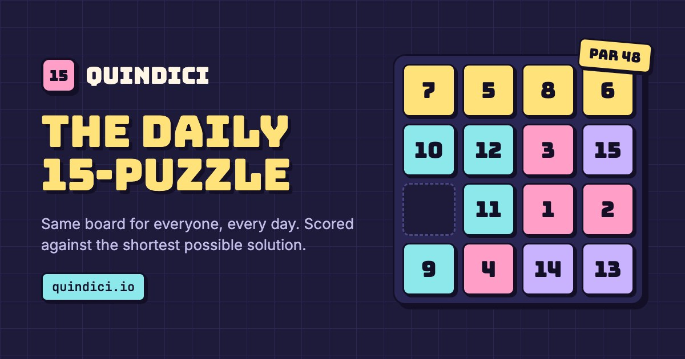
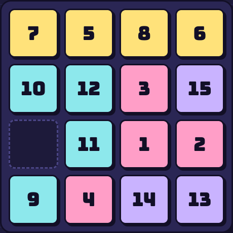
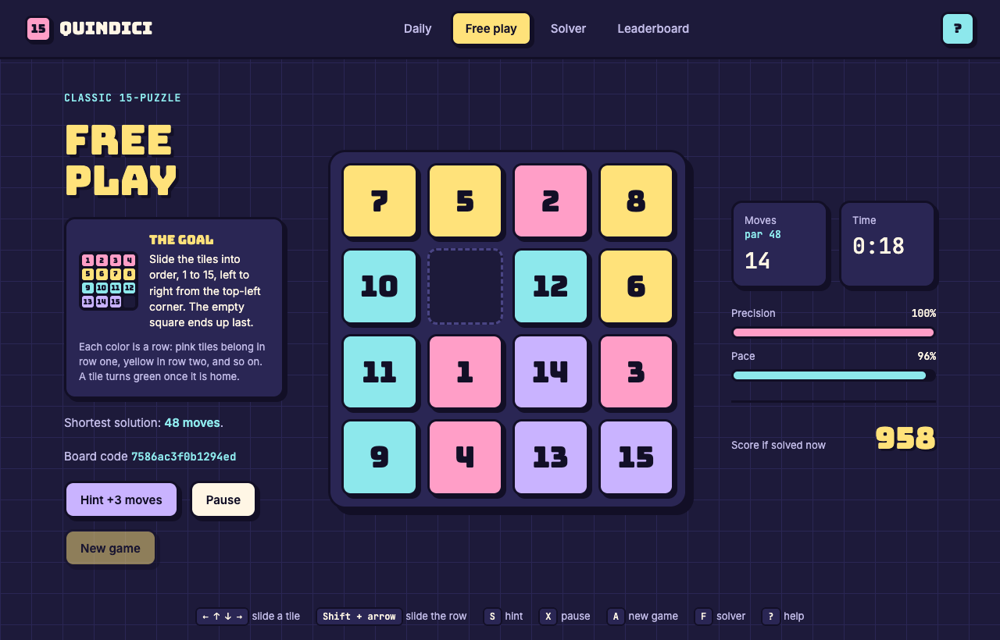
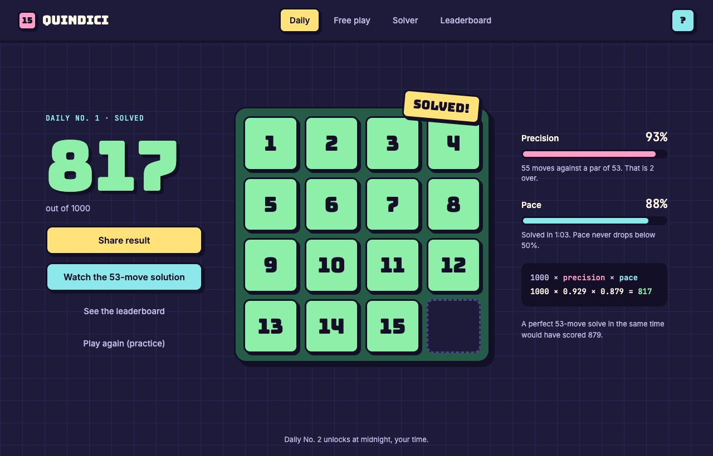
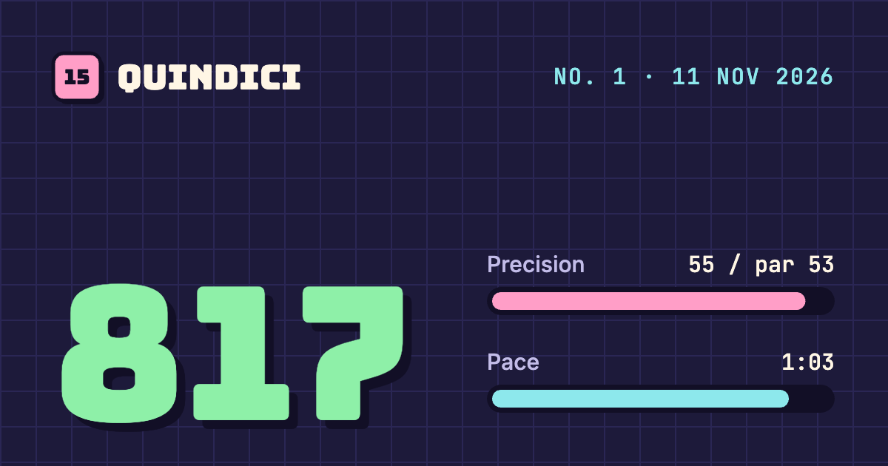
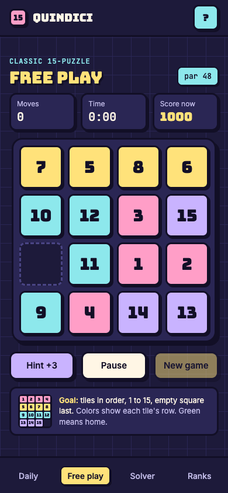
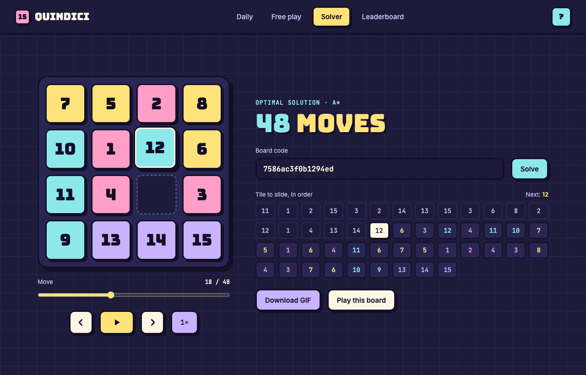
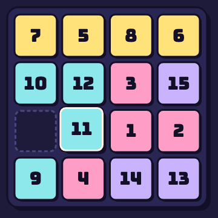

# Quindici

The daily 15-puzzle, crafted by AI with a little human touch. Play at **[quindici.io](https://quindici.io/)**.



# **Introduction**

The **15-puzzle**, also known as the **Game of Fifteen**, is a classic sliding puzzle that has intrigued enthusiasts since the late 19th century. Consisting of a 4x4 grid with 15 numbered square tiles and one empty space, the objective is to rearrange the tiles into sequential order, from 1 to 15, using the empty space to slide tiles into position.



Invented by Noyes Palmer Chapman in 1874, the puzzle gained immense popularity and sparked a global craze due to its deceptively simple design and challenging nature. It has since become a staple in the world of puzzles and continues to be a benchmark for problem-solving and algorithmic research.

Quindici brings it to the web with a daily challenge scored against the shortest possible solution, a leaderboard, free play, hints, keyboard controls, and an optimal solver.

**Colors show where each tile belongs.** Tiles 1–4 are pink, 5–8 yellow, 9–12 cyan and 13–15 lavender: each color is a row. A tile turns green once it is home, and a solved board is all green.



## **Daily Challenge**

Everyone gets the same board each day, chosen by the player's local date. The board stays hidden until you press **Start**, and the clock starts when it appears. Each board's **par** (its shortest solution) is precomputed, and your score runs from 0 to 1000:

```
score     = round(1000 × precision × pace)
precision = (par / moves)²                  moves = tiles moved + 3 × hints
pace      = ½ + ½ × 2^(−seconds / (3 × par))
```

- **Moves matter most.** Precision is squared: 41% over par halves your score.
- **Time can only halve it.** Pace loses half of its remaining bonus every 3 seconds per par move, and never drops below 50%.
- **Every tile counts.** Sliding a whole row with Shift moves several tiles, and each one counts as a move.
- **Your first finished attempt is the one that counts.** Playing again afterwards, or playing a past daily, is practice.



Share your result as spoiler-free text or as an image card:

```
quindici #1 · 817
precision ▰▰▰▰▰▰▰▰▰▱ 55/53
pace      ▰▰▰▰▰▰▰▰▰▱ 1:03
https://quindici.io/daily/1
```



## **Leaderboard**

Finished dailies go to the [leaderboard](https://quindici.io/leaderboard/), with **Today** and **This week** (the total of your scores over the last seven dailies). You get an automatic name like `neon_otter_22`, which you can change from the leaderboard page. Before a result counts, the server replays your moves to check they solve the board and that the time is possible.

## **Free Play and Shared Boards**

[Free play](https://quindici.io/?mode=free) deals a random board and finds its par in the background, so it gets a live score too. Any board can be shared as a 16-character hex code. For example, the array `[7,5,8,6,10,12,3,15,0,11,1,2,9,4,14,13]` is `7586ac3f0b1294ed`, and `https://quindici.io/?board=7586ac3f0b1294ed` opens it:



## **Slide Multiple Tiles**

Multiple tiles can slide at once when the empty square is in the same row or column, just like the physical puzzle.

- **Keyboard**: **Shift + Arrow Key** slides the whole row or column.
- **Mouse or touch**: tap any tile in line with the empty square to slide it along with the tiles between.

## **Hints**

Stuck? A **hint** (**S**) plays the next move of a shortest solution from wherever you are. Each hint adds 3 moves to your score.

## **Keyboard Shortcuts**

- **Arrow keys (↑ ↓ ← →)**: slide the tile next to the empty square into it.
- **Shift + Arrow key**: slide the whole row or column.
- **Enter**: start the daily.
- **S**: hint.
- **X**: pause or resume (pausing hides the board).
- **A**: new game (free play).
- **F**: open the solver for the current board (after you have solved the daily).
- **?**: help.

## **15-Puzzle Solver**

The [solver](https://quindici.io/solver/) finds the optimal solution for any solvable board with **IDA\*** search (Manhattan distance plus linear conflict), then plays it back move by move.



- **Playback**: step through with the scrubber, Previous / Play / Next (or **← →**, **Space**, **Home**, **End**), at 1×, 2× or 4×.
- **Move list**: one chip per move showing the tile to slide; the lifted tile on the board moves next.
- **Animated GIF**: download the whole solution as a GIF.
- **Play this board**: open the same board in free play.

Today's daily stays locked in the solver until you have solved it.

Here is the GIF for the board above (48 moves):



# **Technology**

- **Site**: static HTML, CSS and vanilla JavaScript with no build step, hosted on Netlify. Fonts: Bungee, Inter and JetBrains Mono.
- **Solver**: IDA\* in a Web Worker (`solver/solverWorker.js`), shared by the solver page, hints and free-play par.
- **Daily boards**: precomputed in `daily/boards.json`, each with its par and an optimal solution.
- **Leaderboard**: a Firebase Cloud Function with Firestore (`functions/`, see `functions/README.md`).

# **Running Locally**

```bash
git clone https://github.com/justinpobrien/quindici.git
cd quindici
python3 -m http.server 8000
```

Then open http://localhost:8000. A local server is required, because the daily boards are loaded with `fetch`.

- `?today=YYYY-MM-DD` previews any day's daily (local servers only).
- Locally, the leaderboard talks to the Firebase emulators (`cd functions && npm run serve`); add `?api=prod` to use the live API.
- URLs: `/` today's daily, `/daily/N` a specific daily (past ones are practice), `/?mode=free` free play, `/?board=<hex>` free play on a given board. `/daily/N` is a Netlify rewrite (`_redirects`), so on a plain local server use `/?daily=N` instead; older `?daily=N` links still work everywhere.
- Local results, streaks and the in-progress daily are stored in `localStorage` under `quindici.v1`.
- Tests (all run on every pull request by `.github/workflows/test.yml`):
  - `node --test tests/scoring.test.js`
  - in `functions/`: `npm test` (unit) and `npm run test:emulator` (API against the emulators)
  - in `tests/`: `npm install`, then `npm run test:daily` and `npm run test:leaderboard` (headless Chrome; the leaderboard suite starts the emulators)
- Local emulators use the `demo-quindici` project, which needs no login and never touches production. They read `functions/.secret.local` (`TOKEN_SECRET=anything`) and `functions/.env.local` (`QUINDICI_RELEASE_OFFSET_MS=34560000000`, so every daily counts as released).

## Upkeep: the daily boards

`daily/boards.json` covers **2026-11-11 to 2027-11-10** (Daily No. 1–365). Before it runs out, append the next year (takes about 15 minutes); dates and numbering continue automatically:

```
node scripts/extend-daily.js --days 365
```

Then redeploy the Cloud Function so the server knows the new boards: `firebase deploy --only functions`.

The committed `daily/boards.json` is the source of truth. The generator is seeded by date, but it skips any candidate board that takes more than 4 seconds to solve, so a rerun on a different machine can occasionally pick a different (equally valid) board for a date. Never regenerate dates that are already live. (Boards No. 1–365 were generated for a 2026-12-01 start and moved 20 days earlier when launch moved to 2026-11-11, so regenerating those dates would not reproduce them.)

# **License**

This project is open source under the [MIT License](LICENSE.txt).
